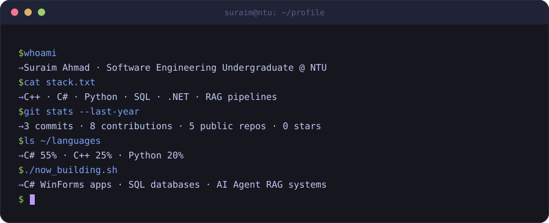
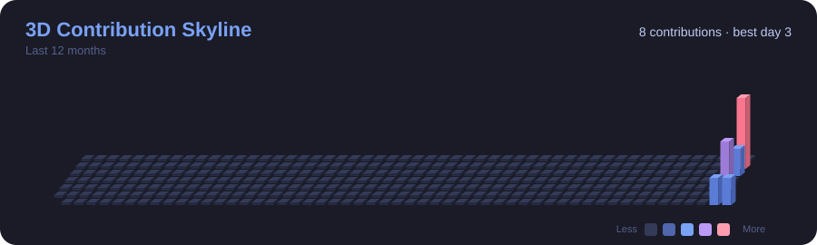

 

---

# 💫 About Me

- 🔭 I’m currently working on: **C# Windows Forms apps, SQL databases & AI Agent RAG systems**
- 👯 I’m looking to collaborate on: **Open-source projects & full-stack C#/C++ development**
- 🤝 I’m looking for help with: **Advanced system design and optimization**
- 🌱 I’m currently learning: **Advanced DSA & solving problems on LeetCode**
- 💬 Ask me about: **C++, C#, Python, SQL, RAG pipelines, and Windows Forms**
- ⚡ Fun fact: Passionate software engineering student building real-world desktop and AI applications!

---

## 🌐 Socials

  
  
  
  

---

# 💻 Tech Stack

        

---

# 🖥️ Terminal

  

---

# 📊 GitHub Stats

  

  

---

# 🏙️ 3D Contribution Skyline

  

---

# 🐍 Contribution Snake

<picture>
  <source media="(prefers-color-scheme: dark)" srcset="https://raw.githubusercontent.com/Suraim189/Suraim189/output/github-snake-dark.svg" />
  <source media="(prefers-color-scheme: light)" srcset="https://raw.githubusercontent.com/Suraim189/Suraim189/output/github-snake.svg" />
  
</picture>

---

  

<!-- Proudly created with GPRM ( https://gprm.itsvg.in ) -->
